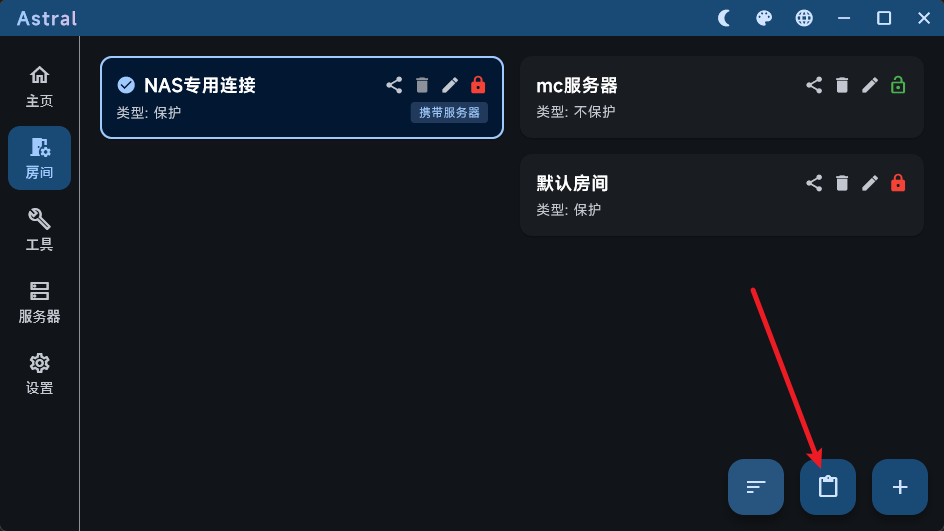
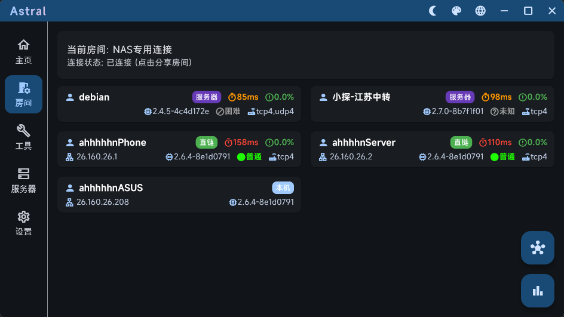
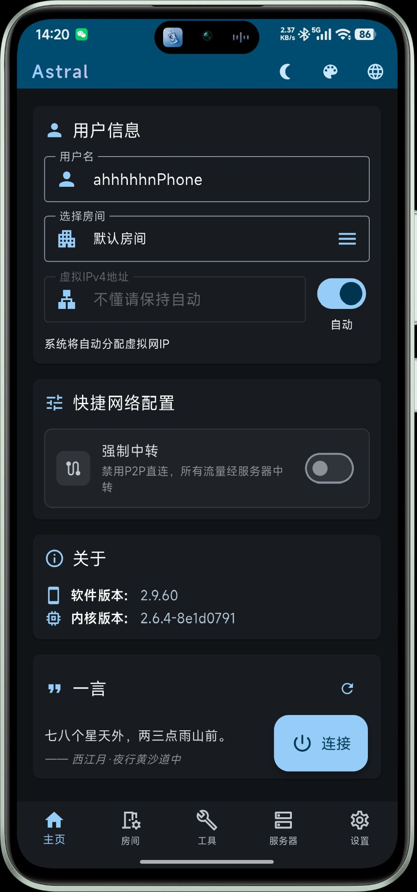
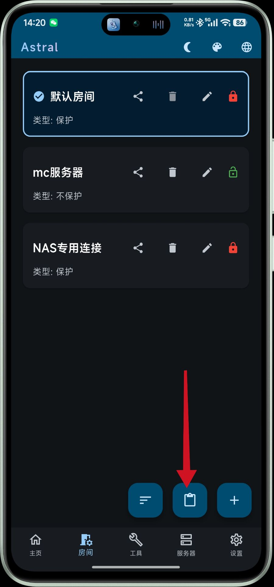
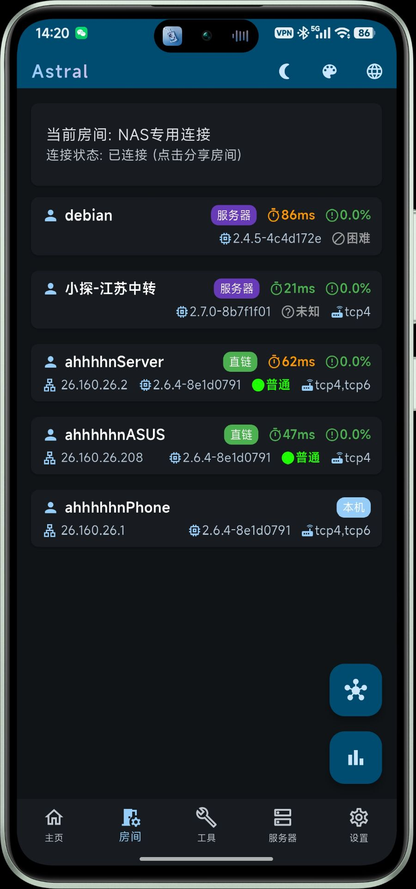

# 前言

**我用手机开了个网络云盘**

>声明：现在处于公开试运行阶段，由于我住校，所以运行时间为**周六晚18:00-周日下午15:00**这个测试窗口
>通过旧手机连Wifi搭建的，家宽有限（多台设备共享不到100M宽带......）速度较慢
>仅做测试和分享用途，请勿存储隐私/私密文件和违法违规文件，请勿外传

这个文档将一步步指导你如何去连接到我的个人网络云盘

同时你也可以用类似方法搭建虚拟专用网络和虚拟局域网
# 操作步骤
## 1.下载联网软件并安装

我们使用**Astral**进行组网服务
下载链接: [蓝奏云下载源点击下载](https://ahhhhhn.lanzouv.com/b007uvvkab) 密码: **fa1z**

>请注意，如果你是从官网下载的Astral，请确认是Astral而不是Astral Next或Astral Game，三者之间有区别，这里我仅提供Astral的下载链接

>Astral目前仅支持Windows，Linux和Android，这里仅提供了Windows和Android的安装包
## 2.连接到网络
### Windows端操作

第一次使用Windows的用户可能要安装NpCap前置，这里我将下载链接放在这里
[NpCap下载链接-蓝奏云](https://ahhhhhn.lanzouv.com/idbce4cfj1eb) 密码: **ev6v**

打开Astral，界面如下

![[4]](./4.png)

左边选择房间，点击右下角导入房间，将以下房间邀请码复制进去（已附带服务器和连接配置）

```
astral://room?code=H4sIAAAAAAAAA32QO07EMBCG7zJ17M04jh274wI0lIjCz7DsJo42WZ7iCjRQ0yFxBDoug4BjIBRphcJm2_n-75_R3EELGo6PTj7eHr-eXr_fnz8fXiCDDWjg0Yhcckd4JRjhviyI5SwS5mUUhrtKoYcMut-oF0xaaUk0GAjnlSMWI5ISuUGJEY3jkEEDGqo8emN9JCZIS7g0gShrI1E8KoHS5EVpIYMAGjPoQZ_C4Dq9WISB1tbRJgWNmGMOGWz9DBiNiiKvKFOU5WLi7EW7PeulT229Tm1Nh9T9XzfDR3_YblraNjUVTKlS0uub20nDocTY0Z_Ty9QsV1vqUqOl-iPvRaN10U8b2Y6lnvau69e_FnXt5KI5Orozp0azCgcDI7wKy7TZ88fp_CwDBxpQqlwpJYtCIIf7H8-RcS-gAgAA
```




然后回到主页，点击连接，再次来到房间，看到房间内就说明成功连接了



此后的连接就只需要在主页选择房间，然后点击连接就可以了

#### 注意
Windows第一次使用的用户在连接时可能会报错，提醒你下载必要文件，即NpCap，用来沟通TCP连接

这个开头说过了，去看吧

### Android端操作

打开Astral，界面如下



下边选择房间，点击右下角导入房间，将以下房间邀请码复制进去（已附带服务器和连接配置）
```
astral://room?code=H4sIAAAAAAAAA32QO07EMBCG7zJ17M04jh274wI0lIjCz7DsJo42WZ7iCjRQ0yFxBDoug4BjIBRphcJm2_n-75_R3EELGo6PTj7eHr-eXr_fnz8fXiCDDWjg0Yhcckd4JRjhviyI5SwS5mUUhrtKoYcMut-oF0xaaUk0GAjnlSMWI5ISuUGJEY3jkEEDGqo8emN9JCZIS7g0gShrI1E8KoHS5EVpIYMAGjPoQZ_C4Dq9WISB1tbRJgWNmGMOGWz9DBiNiiKvKFOU5WLi7EW7PeulT229Tm1Nh9T9XzfDR3_YblraNjUVTKlS0uub20nDocTY0Z_Ty9QsV1vqUqOl-iPvRaN10U8b2Y6lnvau69e_FnXt5KI5Orozp0azCgcDI7wKy7TZ88fp_CwDBxpQqlwpJYtCIIf7H8-RcS-gAgAA
```



再次回到主页，点击连接，提示会开启VPN图标，确认后即可连接，房间界面应如下



这样即为连接成功

此后的连接就只需要在主页选择房间，然后点击连接就可以了

## 3.访问云盘

> 由于此项目在测试阶段，所以云盘服务器不会保持开启，如果有疑问请周末联系QQ：3464046571，或工作日线下单独找我

使用前需保证你已连接至网络，且确认房间中存在用户`ahhhhhnServer`即服务器，否则无法访问服务器

在浏览器中输入如下网址`26.160.26.2:5244`以访问服务器的远程云盘端口

首次进入时需要注册账号，这个暂时无法自行注册，请周末联系QQ：3464046571 或线下联系我提供账号和个人空间

如果想直接使用也可以用这个公用的账户去访问共享存储区（但是不建议在此存放重要的文件，有被熊掉删完了的风险）

```
账号:SharedUser
密码:123
```
# 没了

这是我第二个也是最后一个拿出来公开测试的项目，本身也是想去实现一个心中早已埋下的点子。但是由于时间和精力问题，这个项目可能还存在诸多问题，也请大家多多发表意见（可以发在留言区里或者直接和我说）

Bye~
